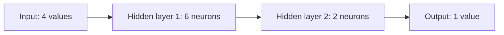

# Galvatrone — a neural network in C++

**English** | [Русский](README.ru.md)

An educational implementation of a fully connected neural network with two
hidden layers. It demonstrates prediction, learning through backpropagation,
and saving learned weights. Storage uses raw dynamic arrays with `new[]` and
`delete[]`; there is no `std::vector` or external machine learning library.

Read in order: [network model](#network-model), [learning logic](#learning-logic),
[function reference](#function-reference), [build and run](#build-and-run),
and [weight format](#weight-format).

## Network model

The model is a feedforward multilayer perceptron. Information moves from input
to output through weighted connections. Every neuron receives signals from all
neurons in the previous layer. There are no recurrent connections or bias terms.

The demonstration uses this architecture:



Layer sizes are constructor arguments. The class supports different sizes,
while the example arrays in both `main()` functions are written for `4 → 6 → 2 → 1`.

| Matrix | Meaning | Default dimensions |
| --- | --- | --- |
| `weightsInputHidden1` | Input → first hidden layer | `4 × 6` |
| `weightsHidden1Hidden2` | First → second hidden layer | `6 × 2` |
| `weightsHidden2Output` | Second hidden layer → output | `2 × 1` |

These matrices hold `38` trainable weights. Each is a `double**` whose rows are
allocated separately. A weight controls how strongly one neuron affects the next.

### What a neuron computes

For neuron `j`, the code multiplies each incoming value by its weight, adds the
products, then applies the sigmoid activation function:

```text
z[j] = sum over i of (a_previous[i] * weight[i][j])
a[j] = sigmoid(z[j]) = 1 / (1 + exp(-z[j]))
```

At the first hidden layer, `a_previous` is the input array. At later layers,
it is the preceding layer's output. Sigmoid maps a sum into the range from `0`
to `1` and makes the mapping nonlinear. Its derivative is `a * (1 - a)`.

A prediction is a numeric output, not an automatically selected class.
The program prints the value directly; it applies no classification threshold.
The demonstration inputs and targets contain only `0` and `1`, but the class
accepts `double` values without automatically clipping or normalizing them.

## Learning logic

Prediction and training use the same forward calculation. Prediction leaves
weights unchanged. Training compares the result with a target and adjusts weights.

### Forward pass

1. Compute weighted sums and sigmoid outputs for the first hidden layer.
2. Use those outputs to calculate the second hidden layer.
3. Use the second hidden layer to calculate the final output.

The variables named `hiddenInputs1`, `hiddenInputs2`, and `finalInputs` contain
weighted sums before activation. `hiddenOutputs1`, `hiddenOutputs2`, and
`finalOutputs` contain the activated values.

### Backpropagation and weight updates

For each training example, the implementation computes:

```text
outputError[j] = target[j] - output[j]
outputDelta[j] = outputError[j] * output[j] * (1 - output[j])

hiddenError[i] = sum over j of (nextDelta[j] * outgoingWeight[i][j])
hiddenDelta[i] = hiddenError[i] * hiddenOutput[i] * (1 - hiddenOutput[i])

weight[i][j] += learningRate * previousOutput[i] * nextDelta[j]
```

The first hidden layer's `previousOutput` is the original input. Deltas are
computed from output back to the first hidden layer, before any weight is changed.
The code then updates the hidden-to-hidden, input-to-hidden, and hidden-to-output
matrices using those deltas.

These updates implement gradient descent on half the sum of squared output errors
for each example. The console displays a different metric: the **sum of absolute
errors** accumulated across examples and outputs during an epoch, without averaging.
Since weights change between examples, this is a running training metric, not a
separate evaluation of one fixed model after the epoch.

Weights are updated after every example: this is online training, or stochastic
gradient descent with a batch size of one. Examples keep their original order;
there is no shuffling. An **epoch** is one pass through all examples.

| Training setting | Default |
| --- | --- |
| Learning rate | `0.9` |
| Maximum epochs | `1 000 000 000` |
| Early stopping | Accumulated absolute error less than `0.11` |
| Logging and weight saving | Every `10 000` epochs, including epoch `0` |

### The current example data

`NN_Training.cpp` contains ten examples. Values above `1` in the original data
were replaced with `1`. The input `[0, 1, 1, 1]` now occurs three times with
respectively `1`, `0`, and `1` as its target. One fixed model gives identical
outputs for identical inputs, so it cannot satisfy these conflicting targets
simultaneously. Convergence to the stopping threshold is not guaranteed, and the
default run may continue to its very large epoch limit.

For a short run, change the training call in `NN_Training.cpp` and rebuild:

```cpp
neuralNet.train(inputRows, targetRows, 10, 0.9, 1000);
```

For consistent training data, identical inputs should have identical targets.

## Function reference

The class is defined separately in [NN_Training.cpp](NN_Training.cpp) and
[nn_main.cpp](nn_main.cpp). Both files contain a `main()`; build them separately.

| Function | Training program | Prediction program |
| --- | --- | --- |
| Constructor and destructor | Yes | Yes |
| `sigmoid` | Yes | Yes |
| `forward` | Yes | Yes |
| `loadWeightsFromFile` | Yes | Yes |
| `initializeRandomWeights` | Yes | — |
| `train` | Yes | — |
| `saveWeightsToFile` | Yes | — |
| Private `allocateMatrix` and `deleteMatrix` | Yes | Yes |

### `NeuralNetwork(inputSize, hiddenSize1, hiddenSize2, outputSize)`

Stores the four layer sizes and allocates the three weight matrices. All sizes
must be positive; otherwise it throws `std::invalid_argument`. If allocation
fails partway through, already allocated matrices are released before rethrowing.
The training version initializes weights randomly; the prediction version starts
with zero weights and expects weights to be loaded from a file.

### `~NeuralNetwork()` and copying

The destructor frees every row and then each matrix's array of row pointers.
Copy construction and copy assignment are explicitly deleted: two network objects
must not own and free the same arrays. Input, target, and result arrays belong
to the caller and are not freed by the network.

### `void initializeRandomWeights()`

Available in the training version. Seeds `rand()` using the current time and
fills all three matrices using `(rand() % 200) / 100.0 - 1.0`: values range from
`-1.00` to `0.99` in increments of `0.01`. Calling it again replaces existing
weights. Seeding affects the global C random generator; networks initialized
within the same second can receive identical initial weights.

### `double sigmoid(double x)`

Returns `1.0 / (1.0 + exp(-x))`. Used after each weighted sum in both hidden layers
and the output layer. Backpropagation uses the derivative of this function.

### `void forward(const double* inputs, double* finalOutputs)`

Runs the three-stage forward pass and writes the prediction into the caller's
output array. It returns no array and does not change weights. Temporary weighted
sums and hidden activations share one dynamically allocated buffer, freed before
returning.

`inputs` must contain at least `inputSize` values; `finalOutputs` must have space
for `outputSize` values. Pointers and lengths are not validated automatically.

### `void train(const double* const* inputs, const double* const* targets, int exampleCount, double learningRate = 0.9, int epochs = 1000000000)`

Available in the training version. Receives arrays of row pointers for examples
and targets. Both pointer arrays need `exampleCount` rows; each input row needs
`inputSize` values and each target row needs `outputSize` values.

Allocates one work buffer for the entire call, then repeats forward calculation,
backpropagation, and weight updates for each example in each epoch. It logs and
saves to `weights.txt` every 10 000 epochs and stops when the accumulated absolute
error is below `0.11` or the epoch limit is reached. The work buffer is released
after the loop, including after early stopping.

The forward calculation is written directly inside `train`; it does not call
`forward`, because learning also needs the intermediate activations. Data pointers,
row lengths, example count, learning rate, and epoch count are not validated here.

### `void loadWeightsFromFile(const string& filename)`

Reads the three weight matrices in order from a whitespace-separated text file.
An open failure prints an error to `cerr` and leaves existing weights unchanged.
The function returns no success flag. It does not validate the file's dimensions,
number of values, or numeric contents; an invalid file can leave partially updated
weights. Use a file produced for the same architecture.

### `void saveWeightsToFile(const string& filename)`

Available in the training version. Opens the file for replacement and writes all
weights in matrix order, separated by spaces. Layer sizes are not included.
Default stream precision can introduce rounding when values are loaded again.
The function returns no success flag and does not report an open or write failure.

### `static double** allocateMatrix(int rows, int columns)` — private

Allocates a zero-initialized array of row pointers and then zero-initialized
`double` rows. Returns the matrix. If a row allocation fails, releases all allocated
rows and the pointer array before rethrowing the exception.

### `static void deleteMatrix(double** matrix, int rows)` — private

Accepts a matrix pointer and its row count, deletes each row, then deletes the
pointer array. Does nothing for `nullptr`. Used during construction cleanup and
destruction; it does not reset the caller's pointer.

### `int main()` in `NN_Training.cpp`

Creates the `4 → 6 → 2 → 1` network, tries to load `weights.txt`, prepares ten
training examples and their row pointers, and calls `train`. After training it
prints predictions for those examples, saves weights again, and releases the
example, target, and result arrays.

### `int main()` in `nn_main.cpp`

Attempts to set a Russian locale, creates the same architecture, and loads
`weights.txt`. Reads a nonnegative example count and four numbers per example.
After reading all examples, prints predictions and frees its arrays.

Zero examples are allowed. Invalid counts and invalid or incomplete numeric input
print an error and return `1`. Valid input returns `0`; a missing weight file alone
does not cause failure. With zero weights, each prediction is `0.5`.

## Build and run

Use a C++11-or-newer compiler. These commands use `g++` on Linux. A UTF-8 terminal
is needed for the programs' Russian console messages. No additional libraries are
required. Run commands from the project root; filenames are case-sensitive.

```bash
g++ -std=c++11 -Wall -Wextra -Wpedantic NN_Training.cpp -o NN_Training
g++ -std=c++11 -Wall -Wextra -Wpedantic nn_main.cpp -o nn_main
```

To train using the built-in examples:

```bash
./NN_Training
```

If no weight file exists, training reports the open error and continues from
random weights. Consider the short-run setting described above before starting
the default billion-epoch demonstration.

To predict using saved weights:

```bash
./nn_main
```

Example console input: two examples, each containing four values.

```text
2
1 0 1 0
0 1 0 1
```

Results depend on the weights. A missing file produces an error message but the
program continues with zero weights; its `0.5` outputs do not represent a learned
model. Both programs use `weights.txt` relative to the current working directory.

### Using the class in the training program

This example can replace the body of `main()` in `NN_Training.cpp`:

```cpp
NeuralNetwork neuralNet(4, 6, 2, 1);
double input[] = {1, 0, 0, 1};
double target[] = {1};
const double* inputs[] = {input};
const double* targets[] = {target};

neuralNet.train(inputs, targets, 1, 0.9, 1000);

double result[1];
neuralNet.forward(input, result);
cout << "Prediction: " << result[0] << endl;
neuralNet.saveWeightsToFile("weights.txt");
return 0;
```

When changing the architecture, update both programs' constructor arguments and
example array dimensions, rebuild, and prepare matching weights. Changing a layer
size alone does not resize the hard-coded example arrays.

## Weight format

The file stores whitespace-separated numbers in this order:

1. `weightsInputHidden1`, row by row.
2. `weightsHidden1Hidden2`, row by row.
3. `weightsHidden2Output`, row by row.

The number of values is:

```text
inputSize * hiddenSize1 + hiddenSize1 * hiddenSize2 + hiddenSize2 * outputSize
```

For the default architecture: `4 * 6 + 6 * 2 + 2 * 1 = 38`.
There are no headers, layer sizes, bias values, or other metadata.
Training and prediction must agree on both dimensions and matrix order.

[Читать на русском](README.ru.md)
