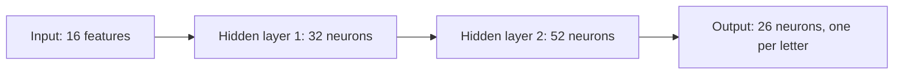

# Galvatrone — letter recognition with a C++ neural network

**English** | [Русский](README.ru.md)

This branch (`example`) applies the from-scratch neural network from the `main`
branch to a real task: recognising the 26 capital letters of the English alphabet.
It is the solution for COMP447 Project 1 (Letter Recognition Using an MLP).
The lecturer allowed C++ instead of Python for this project.

No machine learning libraries are used. The network, training, data split,
scaling and evaluation are written by hand in C++11 with raw `new[]`/`delete[]`
arrays, in the same style as the `main` branch. The `main` branch keeps the small
learning version of the network; this branch is independent from it.

## Data

`ocrData.txt` is the UCI Letter Recognition dataset (Frey & Slate, 1991).
It has 20 000 lines. Each line is one letter image described by 16 integer
features from 0 to 15:

```text
T,2,8,3,5,1,8,13,0,6,6,10,8,0,8,0,8
```

The first value is the letter, the next 16 are the features. The images were
made from 20 fonts, and every letter was randomly distorted. The pixels are not
in the file; only the 16 numbers computed from them:

| # | Name | Meaning |
| --- | --- | --- |
| 1 | x-box | horizontal position of the box around the letter |
| 2 | y-box | vertical position of the box |
| 3 | width | width of the box |
| 4 | high | height of the box |
| 5 | onpix | number of black pixels (scaled) |
| 6 | x-bar | mean x of black pixels |
| 7 | y-bar | mean y of black pixels |
| 8 | x2bar | variance of x |
| 9 | y2bar | variance of y |
| 10 | xybar | correlation of x and y |
| 11 | x2ybr | mean of x·x·y |
| 12 | xy2br | mean of x·y·y |
| 13 | x-ege | mean number of edges from left to right |
| 14 | xegvy | correlation of x-ege with y |
| 15 | y-ege | mean number of edges from bottom to top |
| 16 | yegvx | correlation of y-ege with x |

All 26 letters have between 734 and 813 examples, so the classes are almost balanced.

## Network



- 32 neurons in the first hidden layer: two for each input feature.
- 52 neurons in the second hidden layer: two for each letter.
- 26 outputs: output `k` is the letter `'A' + k`. The predicted letter is the
  output with the largest value.
- Every neuron has a weight for each neuron of the previous layer and a bias.
- Activation: sigmoid in all layers.
- Training: backpropagation with stochastic gradient descent, one example at a time,
  learning rate `0.1`, `500` epochs.

The network has `16·32 + 32·52 + 52·26 = 3528` weights and `32 + 52 + 26 = 110`
biases, `3638` trainable numbers in total.

## How `NN_Training` works

1. Creates the `16 → 32 → 52 → 26` network. If `letters_weights.txt` exists, it
   loads it and continues training. If the file does not exist, it starts from
   random weights. If the file exists but is broken, it stops without overwriting it.
2. Reads `ocrData.txt`. Letters become class numbers `A=0 … Z=25`.
3. Splits the data 80% / 20% with stratification: each letter is shuffled and split
   separately, so every letter has the same share in train and test. The training
   part is shuffled once more so letters are mixed.
4. Scales every feature to `[0, 1]` with `(x − min) / (max − min)`. `min` and `max`
   are found **on the training data only** and saved to `letters_scaling.txt`.
5. Builds one-hot targets: `1` for the correct letter, `0` for the other 25.
6. Trains on the training data. Every 10 epochs it prints the total absolute error
   and saves the weights.
7. Prints training accuracy, test accuracy, the labelled 26×26 confusion matrix
   for the test data and the 10 most frequent mistakes. Saves the weights and
   `confusion_matrix.csv`.

The random weights and the split both use the fixed seed `SEED = 31415962`,
so a run from scratch gives the same result every time on the same system.
`rand()` is different in different C libraries, so Windows and Linux can give
slightly different numbers.

## How `nn_main` works

Loads `letters_weights.txt` and `letters_scaling.txt`, reads the number of examples
and then 16 features for each example (a line of `ocrData.txt` without the letter).
It scales the input in the same way as training and prints the predicted letter:

```text
Enter the number of examples: 1
Enter 16 features for example 1: 2 8 3 5 1 8 13 0 6 6 10 8 0 8 0 8
Input: 2,8,3,5,1,8,13,0,6,6,10,8,0,8,0,8 Prediction: T (output 0.999946)
```

If a file is missing or broken, or the input is not a number, it prints an error
and returns `1`.

## Build and run

```bash
g++ -std=c++11 -O2 -Wall -Wextra -o NN_Training NN_Training.cpp
g++ -std=c++11 -O2 -Wall -Wextra -o nn_main nn_main.cpp
./NN_Training          # about 50 seconds for 500 epochs
./nn_main
```

Run the programs from the project folder: all files are read and written in the
current directory. To train from scratch, delete `letters_weights.txt` first;
otherwise every run adds 500 more epochs to the saved weights.

## Results

From scratch, seed `31415962`, 500 epochs, learning rate `0.1`
(g++ 16.2.1, Linux):

| | Accuracy |
| --- | --- |
| Training (15 998 examples) | 93.70% |
| Test (4 002 examples) | 91.08% |

## Files

| File | Content |
| --- | --- |
| `NN_Training.cpp` | network, data loading, split, scaling, training, evaluation |
| `nn_main.cpp` | prediction of a letter from 16 features |
| `ocrData.txt` | dataset |
| `letters_weights.txt` | trained weights |
| `letters_scaling.txt` | `min` (line 1) and `max` (line 2) of each feature on the training data |
| `confusion_matrix.csv` | test confusion matrix; rows are true letters, columns are predicted letters |

## Weight format

`letters_weights.txt` contains whitespace-separated numbers, one group per line:

1. `weightsInputHidden1` (16 × 32), row by row.
2. `weightsHidden1Hidden2` (32 × 52), row by row.
3. `weightsHidden2Output` (52 × 26), row by row.
4. `biasHidden1` (32), `biasHidden2` (52), `biasOutput` (26).

Numbers are saved with full `double` precision. The file is written to
`letters_weights.txt.tmp` first and then renamed, so an interrupted save does not
damage the old file. Loading checks that there are exactly 3638 numbers.

## Reference

P. W. Frey and D. J. Slate. Letter Recognition Using Holland-Style Adaptive
Classifiers. *Machine Learning*, 6(2), 1991.
Dataset: UCI Machine Learning Repository, Letter Recognition.

[Читать на русском](README.ru.md)
