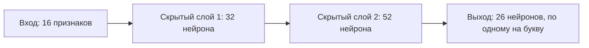

# Galvatrone — распознавание букв нейросетью на C++

[English](README.md) | **Русский**

Эта ветка (`example`) применяет написанную с нуля нейросеть из ветки `main`
к реальной задаче: распознаванию 26 заглавных букв английского алфавита.
Это решение COMP447 Project 1 (Letter Recognition Using an MLP).
Преподаватель разрешил писать проект на C++ вместо Python.

Библиотеки машинного обучения не используются. Сеть, обучение, разбиение
данных, масштабирование и оценка написаны вручную на C++11 с динамическими
массивами `new[]`/`delete[]`, в том же стиле, что и в ветке `main`. Комментарии в коде и вывод программ — на английском. В `main`
остаётся маленькая учебная версия сети; эта ветка от неё не зависит.

Отчёт по проекту — в [REPORT.md](REPORT.md) (на английском).

## Данные

`ocrData.txt` — набор UCI Letter Recognition (Frey & Slate, 1991).
В нём 20 000 строк. Каждая строка — одна картинка буквы, описанная 16 целыми
признаками от 0 до 15:

```text
T,2,8,3,5,1,8,13,0,6,6,10,8,0,8,0,8
```

Первое значение — буква, следующие 16 — признаки. Картинки сделаны из 20 шрифтов,
каждая буква случайно искажена. Самих пикселей в файле нет, только 16 чисел,
посчитанных по ним:

| № | Имя | Что означает |
| --- | --- | --- |
| 1 | x-box | положение рамки вокруг буквы по горизонтали |
| 2 | y-box | положение рамки по вертикали |
| 3 | width | ширина рамки |
| 4 | high | высота рамки |
| 5 | onpix | число закрашенных пикселей (масштабированное) |
| 6 | x-bar | средний x закрашенных пикселей |
| 7 | y-bar | средний y закрашенных пикселей |
| 8 | x2bar | разброс (дисперсия) по x |
| 9 | y2bar | разброс по y |
| 10 | xybar | корреляция x и y |
| 11 | x2ybr | среднее x·x·y |
| 12 | xy2br | среднее x·y·y |
| 13 | x-ege | среднее число краёв при проходе слева направо |
| 14 | xegvy | связь x-ege с y |
| 15 | y-ege | среднее число краёв при проходе снизу вверх |
| 16 | yegvx | связь y-ege с x |

У каждой из 26 букв от 734 до 813 примеров, то есть классы почти сбалансированы.

## Сеть



- 32 нейрона в первом скрытом слое: по два на каждый входной признак.
- 52 нейрона во втором скрытом слое: по два на каждую букву.
- 26 выходов: выход `k` — это буква `'A' + k`. Предсказанная буква — выход
  с наибольшим значением.
- У каждого нейрона есть вес для каждого нейрона предыдущего слоя и смещение (bias).
- Активация: сигмоида во всех слоях.
- Обучение: обратное распространение ошибки, стохастический градиентный спуск
  по одному примеру, скорость обучения `0.1`, `500` эпох.

В сети `16·32 + 32·52 + 52·26 = 3528` весов и `32 + 52 + 26 = 110` смещений,
всего `3638` обучаемых чисел.

## Как работает `NN_Training`

1. Создаёт сеть `16 → 32 → 52 → 26`. Если есть `letters_weights.txt`, загружает
   его и продолжает обучение. Если файла нет, начинает со случайных весов.
   Если файл есть, но испорчен, останавливается и не перезаписывает его.
2. Читает `ocrData.txt`. Буквы превращаются в номера классов `A=0 … Z=25`.
3. Делит данные 80% / 20% со стратификацией: примеры каждой буквы перемешиваются
   и делятся отдельно, поэтому доля каждой буквы в train и test одинаковая.
   Обучающая часть ещё раз перемешивается, чтобы буквы шли вперемешку.
4. Приводит каждый признак к `[0, 1]` по формуле `(x − min) / (max − min)`.
   `min` и `max` ищутся **только по обучающим данным** и сохраняются
   в `letters_scaling.txt`.
5. Строит цели one-hot: `1` у правильной буквы, `0` у остальных 25.
6. Обучает сеть на обучающих данных. Каждые 10 эпох выводит суммарную абсолютную
   ошибку и сохраняет веса.
7. Выводит точность на train и на test, подписанную матрицу ошибок 26×26 для test
   и 10 самых частых ошибок. Сохраняет веса и `confusion_matrix.csv`.

Случайные веса и разбиение используют фиксированный seed `SEED = 31415962`,
поэтому обучение с нуля на одной и той же системе каждый раз даёт одинаковый
результат. `rand()` в разных библиотеках C разный, поэтому в Windows и Linux
цифры могут немного отличаться.

## Как работает `nn_main`

Загружает `letters_weights.txt` и `letters_scaling.txt`, читает количество примеров
и по 16 признаков на каждый (строка `ocrData.txt` без буквы). Масштабирует ввод
так же, как при обучении, и выводит предсказанную букву:

```text
Enter the number of examples: 1
Enter 16 features for example 1: 2 8 3 5 1 8 13 0 6 6 10 8 0 8 0 8
Input: 2,8,3,5,1,8,13,0,6,6,10,8,0,8,0,8 Prediction: T (output 0.999946)
```

Если файла нет или он испорчен, или ввод не число, программа выводит ошибку
и возвращает `1`.

## Сборка и запуск

```bash
g++ -std=c++11 -O2 -Wall -Wextra -o NN_Training NN_Training.cpp
g++ -std=c++11 -O2 -Wall -Wextra -o nn_main nn_main.cpp
./NN_Training          # около 50 секунд на 500 эпох
./nn_main
```

Запускайте программы из папки проекта: все файлы читаются и пишутся в текущей
папке. Чтобы обучить с нуля, сначала удалите `letters_weights.txt`; иначе каждый
запуск добавляет ещё 500 эпох к сохранённым весам.

## Результаты

С нуля, seed `31415962`, 500 эпох, скорость обучения `0.1`
(g++ 16.2.1, Linux):

| | Точность |
| --- | --- |
| Train (15 998 примеров) | 93.70% |
| Test (4 002 примера) | 91.08% |

Подробный разбор — в [REPORT.md](REPORT.md).

## Файлы

| Файл | Содержимое |
| --- | --- |
| `NN_Training.cpp` | сеть, загрузка данных, разбиение, масштабирование, обучение, оценка |
| `nn_main.cpp` | предсказание буквы по 16 признакам |
| `ocrData.txt` | набор данных |
| `letters_weights.txt` | обученные веса |
| `letters_scaling.txt` | `min` (строка 1) и `max` (строка 2) каждого признака на train |
| `confusion_matrix.csv` | матрица ошибок на test: строки — настоящие буквы, столбцы — предсказанные |
| `REPORT.md` | отчёт по проекту |

## Формат весов

`letters_weights.txt` содержит числа, разделённые пробелами, по группе на строку:

1. `weightsInputHidden1` (16 × 32), строка за строкой.
2. `weightsHidden1Hidden2` (32 × 52), строка за строкой.
3. `weightsHidden2Output` (52 × 26), строка за строкой.
4. `biasHidden1` (32), `biasHidden2` (52), `biasOutput` (26).

Числа сохраняются с полной точностью `double`. Сначала файл пишется
в `letters_weights.txt.tmp`, затем переименовывается, поэтому прерванное
сохранение не портит старый файл. При загрузке проверяется, что чисел ровно 3638.

## Источник

P. W. Frey and D. J. Slate. Letter Recognition Using Holland-Style Adaptive
Classifiers. *Machine Learning*, 6(2), 1991.
Данные: UCI Machine Learning Repository, Letter Recognition.

[Read in English](README.md)
